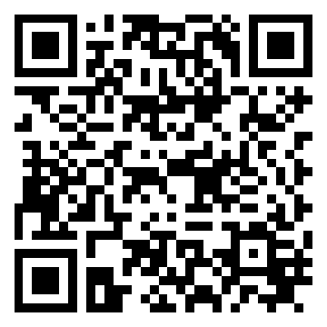
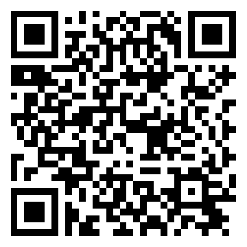
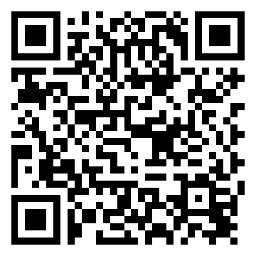
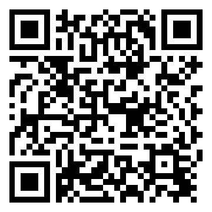

<div align="center">
  
  <h1>Fun Strike! Game Zone — Digital Participant Waiver</h1>
  <p>
    <strong>Fun Strikes Entertainment LLP</strong> &bull; Surat, Gujarat<br />
    Mobile &amp; Tablet-First Waiver Form for <strong>Go-Karting</strong>, <strong>Soft Play &amp; Trampoline</strong>, and <strong>Bowling</strong>
  </p>
  <p>
    <a href="https://funstrikes24-cloud.github.io/fun-strike-waiver/"><strong>Open Live Waiver Form</strong></a>
    &bull;
    <a href="https://funstrike.in">Website</a>
    &bull;
    <a href="mailto:info@funstrike.in">info@funstrike.in</a>
  </p>
</div>

---

## Scan & Open QR Codes (Main + 3 Activity Counters)

Print or display these QR codes at your reception and zone entrances so guests can fill and sign waivers on their own phones or counter tablets:

| Main Waiver Portal | Go-Karting Counter | Soft Play & Trampoline | Bowling Alley |
| :---: | :---: | :---: | :---: |
|  |  |  |  |
| [Open Main Site](https://funstrikes24-cloud.github.io/fun-strike-waiver/) | [Open Go-Karting](https://funstrikes24-cloud.github.io/fun-strike-waiver/?zone=gokart) | [Open Soft Play](https://funstrikes24-cloud.github.io/fun-strike-waiver/?zone=softplay) | [Open Bowling](https://funstrikes24-cloud.github.io/fun-strike-waiver/?zone=bowling) |
| [`qr-main.png`](assets/qr/qr-main.png) | [`qr-gokart.png`](assets/qr/qr-gokart.png) | [`qr-softplay.png`](assets/qr/qr-softplay.png) | [`qr-bowling.png`](assets/qr/qr-bowling.png) |

---

## Key Features

- **Phone & Tablet Optimized:** Responsive single-column mobile layout, 44–48px touch targets, 16px inputs (prevents iOS auto-zoom), and an enlarged `150px` HiDPI touch signature pad.
- **Single-Activity Selection:** Customers pick one zone per waiver (**Go-Karting**, **Soft Play & Trampoline**, or **Bowling**) — or arrive directly via `?zone=` QR links — displaying only the relevant safety rules.
- **Multiple Participants on One Waiver:** Add up to 20 participants (children, family, or group members) on one form with live age calculation and `Minor (<18)` tagging. Also supports a parent/guardian signing on behalf of children without riding.
- **Complete Terms & Conditions:**
  - Zone-specific safety rules (Go-Kart track & double-seat rules, Trampoline grip-socks & no-flips rules, Bowling shoes & foul-line rules).
  - Medical fitness & minor supervision disclosures.
  - **Equipment Breakage & Damage Liability:** Customers are responsible for repair/replacement costs for any damage caused.
  - **Strict No-Refund Policy:** All tickets and session payments are non-refundable and non-transferable once paid.
- **3-Zone Google Sheets Storage & Archiving:**
  - Routes each submission into its own zone spreadsheet (**Go-Karting**, **Soft Play & Trampoline**, or **Bowling**) with **one row per participant**.
  - Separates records automatically into monthly tabs (`YYYY-MM`), creates monthly snapshots in **Monthly Archives**, and transfers completed years into a single **1-Year Combined Archive** file in **Yearly Archives** while keeping the 3 live sheets intact.
  - Includes an on-sheet **Print Selected Row** waiver dialog with the participant roster table and captured signature.
- **Print / Save PDF Ready:** Dedicated A4 `@media print` styling for browser printing and blank paper backups.

---

## Repository Structure

```text
fun-strike-waiver/
├── index.html                  # Responsive waiver form & rules for all 3 zones
├── styles.css                  # Desktop, tablet, phone & A4 print stylesheets
├── app.js                      # Form validation, multi-participant logic, e-signature & submit handler
├── assets/
│   ├── funstrike-logo.png      # Official Fun Strike! Game Zone logo
│   └── qr/
│       ├── qr-main.png         # Main site QR code
│       ├── qr-gokart.png       # Go-Karting QR code (?zone=gokart)
│       ├── qr-softplay.png     # Soft Play & Trampoline QR code (?zone=softplay)
│       └── qr-bowling.png      # Bowling QR code (?zone=bowling)
└── README.md
```

---

<p align="center">
  Made with ❤️ by <a href="https://www.linkedin.com/in/aryanpandya"><strong>Aryan</strong></a> &bull; <a href="https://nexoraonesolution.com/"><strong>NexoraOneSolution</strong></a>
</p>
