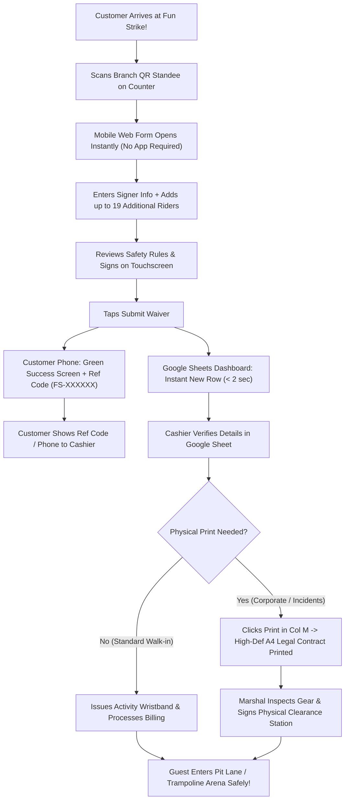

# 🏎️ Fun Strike! Game Zone — Digital Participant Waiver & Legal Indemnity System

<div align="center">
  
  <br /><br />

  [](https://funstrikes24-cloud.github.io/fun-strike-waiver/)
  [](LICENSE)
  [](docs/STAFF-TRAINING-AND-USER-MANUAL.md)
  [](docs/STAFF-TRAINING-AND-USER-MANUAL.md)
  [](styles.css)
  [](google-apps-script/Code.gs)

  <p>
    <strong>Fun Strikes Entertainment LLP</strong> &bull; Surat, Gujarat, India<br />
    <em>An Enterprise-Grade, 100% Paperless, Legally Binding Digital Waiver &amp; Queue Management Ecosystem</em>
  </p>

  <p>
    <a href="https://funstrikes24-cloud.github.io/fun-strike-waiver/pal-gokart"><strong>🏎️ Pal Go-Karting Track (18+)</strong></a>
    &nbsp;&bull;&nbsp;
    <a href="https://funstrikes24-cloud.github.io/fun-strike-waiver/pal-trampoline"><strong>🤸 Pal Trampoline &amp; Soft Play</strong></a>
    &nbsp;&bull;&nbsp;
    <a href="https://funstrikes24-cloud.github.io/fun-strike-waiver/motavarachha-softplay"><strong>🎪 Mota Varachha Trampoline</strong></a>
    &nbsp;&bull;&nbsp;
    <a href="docs/STAFF-TRAINING-AND-USER-MANUAL.md"><strong>📖 Staff Training Manual</strong></a>
  </p>
</div>

---

## 📌 Executive Summary

**Fun Strike! Game Zone** is Surat's premier family entertainment and racing center. This repository powers the venue's end-to-end digital check-in and participant indemnification system, replacing slow, error-prone paper clipboards with lightning-fast smartphone QR self-registration and real-time counter verification.

Compliant with the **Indian Information Technology Act, 2000 (Sections 4 & 10A)**, the system secures legally binding digital e-signatures, generates audit trails, synchronizes entries to cloud Google Sheets within seconds, and allows counter reception to generate continuous, dynamic A4 legal printouts with a single click.

---

## 📍 Live Branch Portals & Standee Quick Links

Each branch and activity operates on a dedicated, locked portal to completely eliminate customer mistakes during registration.

| Branch Location | Activity Track | Age & Eligibility | Dedicated Live URL | Fallback URL | Counter QR Standee PDF |
| :--- | :--- | :--- | :--- | :--- | :--- |
| **Pal (Gauravpath Road)** | **Go-Karting Track** | **Strictly 18+** &bull; Min Height $5\text{ ft } 5\text{ in}$ ($165\text{ cm}$) | [`gokart.funstrike.nexoraonesolution.com`](https://gokart.funstrike.nexoraonesolution.com) | [`.../pal-gokart`](https://funstrikes24-cloud.github.io/fun-strike-waiver/pal-gokart) | [Pal-GoKarting.pdf](printables/Fun-Strike-QR-Pal-GoKarting.pdf) |
| **Pal (Gauravpath Road)** | **Soft Play & Trampoline** | **All Ages** &bull; Grip Socks Mandatory | [`pal.funstrike.nexoraonesolution.com`](https://pal.funstrike.nexoraonesolution.com) | [`.../pal-trampoline`](https://funstrikes24-cloud.github.io/fun-strike-waiver/pal-trampoline) | [Pal-Trampoline.pdf](printables/Fun-Strike-QR-Pal-Trampoline.pdf) |
| **Mota Varachha** | **Soft Play & Trampoline** | **All Ages** &bull; Grip Socks Mandatory | [`varachha.funstrike.nexoraonesolution.com`](https://varachha.funstrike.nexoraonesolution.com) | [`.../motavarachha-softplay`](https://funstrikes24-cloud.github.io/fun-strike-waiver/motavarachha-softplay) | [MotaVarachha.pdf](printables/Fun-Strike-QR-MotaVarachha-Trampoline.pdf) |

> 📁 **All Standees Master Pack**: [Fun-Strike-All-Branches-QR-Codes.pdf](printables/Fun-Strike-All-Branches-QR-Codes.pdf) (High-DPI 3-Page Master Pack ready for acrylic counter display).

---

## 🚀 Key System Features & Highlights

### 1. 📱 Mobile & Tablet-First Architecture
* **Single-Column Touch Layout**: Under $768\text{px}$ viewports, all form grids collapse gracefully into a single full-width column (`1fr`) with zero horizontal clipping.
* **Finger-Friendly Touch Targets**: Inputs, selects, and buttons have a minimum touch height of $48\text{px}$ and font size $\ge 15\text{px}$ to prevent iOS Safari auto-zoom.
* **Integrated Signature Pad**: Smooth, high-precision HTML5 Canvas touch signature pad with anti-aliasing and instant clear button.
* **No In-Form Dropdowns**: Eliminates user confusion by hardcoding the venue and activity directly per branch portal.

### 2. 🖨️ Continuous Dynamic Legal PDF Generation
* **Natural Page Flow**: Unlike legacy templates that forced rigid page splits and left giant empty voids, this engine uses continuous flow with CSS `break-inside: avoid;`.
* **Zero Void Spacing**: Schedule III legal covenants begin immediately beneath Schedule II participant tables. If a page fills naturally, it breaks cleanly to the next page.
* **Single-Line Participant Rule**: Every driver/jumper name remains strictly on **one line** (`white-space: nowrap;`), ensuring crisp readability for long Indian compound names.
* **Dynamic Scalability**:
  * 1 to 5 Participants $\rightarrow$ Clean, compact 2-page legal document.
  * 10 to 20 Participants $\rightarrow$ Elegantly paginated 3-page document with full signatures, audit trail, and marshal station intact.

### 3. ⚖️ Activity-Specific Legal Enforceability
* **Go-Karting Track (18+)**:
  * 100% Sole Minor Liability Clause & mandatory parent/guardian warranty.
  * Minimum height requirement of $5\text{ ft } 5\text{ in}$ ($165\text{ cm}$) and mandatory closed-toe shoes.
  * Zero-tolerance kart bumping/ramming policy with remote engine cutoff.
  * Customer property damage liability for engines, chassis, and track barriers.
  * Marshal Check: `STATUS: CLEARED FOR TRACK`.
* **Soft Play & Trampoline Arena**:
  * Mandatory non-slip rubber grip socks protocol.
  * One person per trampoline bed rule (prevents double-bouncing injuries).
  * Strict ban on somersaults, inverted flips, and head-first foam pit diving.
  * Separate Soft Play toddler zone protection (under 5 years only).
  * Marshal Check: `STATUS: CLEARED FOR ARENA`.

### 4. ⚡ Real-Time Cloud Synchronization
* **Zero Database Hosting Costs**: Leverages Google Sheets as an encrypted real-time operational dashboard and audit archive.
* **Google Apps Script V8 Engine**: High-performance backend receiver (`Code.gs`) processes submissions in $< 1.5$ seconds.
* **Instant Ref Code**: Customers receive a 6-character reference code (e.g., `FS-QM4B9Z`) to present at the billing counter.
* **One-Click Cashier Printing**: Cashiers can click **`🖨️ Print Legal Waiver`** in Google Sheets to immediately open and print the framed A4 contract.

---

## 🔄 End-to-End Operational Workflow



---

## 📂 Repository Directory Layout

```text
fun-strike-waiver/
├── LICENSE                                # Commercial Proprietary License Agreement (Not Open Source)
├── README.md                              # Master enterprise repository documentation
├── index.html                             # Root router (redirects to /pal-gokart/)
├── styles.css                             # Production unified responsive stylesheet
├── app.js                                 # Production client-side validation & signature logic
├── 404.html                               # Fallback 404 error handler
├── CNAME                                  # Custom domain binding
├── generate-qr-pdf.js                     # Root CLI shortcut to QR standee generator
│
├── assets/                                # Core static assets
│   ├── images/
│   │   └── funstrike-logo.png             # Official brand logo
│   └── qr/                                # 600+ DPI high-contrast vector QR codes
│       ├── qr-pal-gokart.png
│       ├── qr-pal-trampoline.png
│       └── qr-motavarachha-softplay.png
│
├── docs/                                  # Complete Operational Manuals & SOPs
│   ├── STAFF-TRAINING-AND-USER-MANUAL.md  # Official Staff Training, Cashier & Marshal SOP
│   ├── GOOGLE-SHEETS-SETUP.md             # Google Sheets & Apps Script cloud setup guide
│   ├── DNS-DOMAIN-SETUP.md                # Subdomains & DNS configuration
│   └── ARCHITECTURE.md                    # Technical system architecture specifications
│
├── google-apps-script/
│   └── Code.gs                            # Cloud backend receiver & dynamic HTML print generator
│
├── scripts/                               # Automation, verification & maintenance tools
│   ├── generate-qr-pdf.js                 # High-DPI counter standee PDF generator
│   ├── sync-flow-code-gs.js               # Synchronizes print HTML templates to Apps Script
│   ├── test-natural-flow.js               # Core natural-flow print renderer engine
│   └── test-1-10-20.js                    # Automated multi-participant verification suite (1, 10, 20)
│
├── printables/                            # Verified print outputs & vector templates
│   ├── Fun-Strike-All-Branches-QR-Codes.pdf       # 3-Page Master Acrylic Standee Pack
│   ├── Fun-Strike-QR-Pal-GoKarting.pdf           # Pal Go-Karting Counter Standee
│   ├── Fun-Strike-QR-Pal-Trampoline.pdf          # Pal Trampoline Counter Standee
│   ├── Fun-Strike-QR-MotaVarachha-Trampoline.pdf # Mota Varachha Standee
│   ├── verify-gokart-1.pdf                       # Verified 1-driver legal printout
│   ├── verify-gokart-10.pdf                      # Verified 10-driver legal printout
│   ├── verify-gokart-20.pdf                      # Verified 20-driver legal printout
│   ├── verify-trampoline-1.pdf                   # Verified 1-jumper legal printout
│   ├── verify-trampoline-10.pdf                  # Verified 10-jumper legal printout
│   ├── verify-trampoline-20.pdf                  # Verified 20-jumper legal printout
│   └── test-waiver.html                          # Pure HTML test template with live mock data
│
├── pal-gokart/                            # Dedicated Pal Go-Karting Portal (18+ & 5'5"+)
│   └── index.html
├── pal-trampoline/                        # Dedicated Pal Soft Play & Trampoline Portal
│   └── index.html
└── motavarachha-softplay/                 # Dedicated Mota Varachha Trampoline Portal
    └── index.html
```

---

## 📖 Operational Documentation & Manuals

Comprehensive guides have been authored for every tier of management and staff:

* **[Staff Training Module & Operating Manual](docs/STAFF-TRAINING-AND-USER-MANUAL.md)**:
  * Cashier opening & closing checklists.
  * Go-Karting pit lane marshal safety checklist (helmets, shoes, height, flags).
  * Trampoline court monitor protocol (grip socks, 1-per-mat, stunt bans).
  * Customer troubleshooting (no internet, dead phone, corrections).
  * Emergency response & equipment damage assessment protocol.
* **[Google Sheets & Automation Setup](docs/GOOGLE-SHEETS-SETUP.md)**:
  * Column mapping reference (Col A through Col M).
  * Apps Script trigger configuration and monthly archive protocol.
* **[DNS & Domain Configuration](docs/DNS-DOMAIN-SETUP.md)**:
  * Setup guide for `gokart.funstrike.nexoraonesolution.com`, `pal.funstrike...`, and `varachha.funstrike...`.
* **[Architecture & Routing](docs/ARCHITECTURE.md)**:
  * Static file distribution and responsive layout hierarchy.

---

## 🖨️ Counter Acrylic Standee Printing Guide

To ensure maximum scanning speed and durability at the reception desk:

1. Open the desired PDF from the [`printables/`](printables/) folder.
2. In your computer's print dialog (`Ctrl + P`):
   * **Paper Size**: `A4`
   * **Paper Type / Media**: `Glossy Photo Paper` or `Heavy Matte Cardstock (220–300 GSM)`
   * **Print Quality**: `High` / `Best` (600–1200 DPI)
   * **Scale**: `100%` / `Actual Size`
   * **Margins**: `None` / `Minimum`
3. Insert the printed photo sheet into a **T-shaped or L-shaped Clear Acrylic Countertop Standee ($8.5\times 11\text{ in}$ / A4)**.
4. Position at eye level next to each cash register and queue stanchion.

---

## 🧪 Automated Print Verification Suite (1, 10, & 20 Participants)

To guarantee that any future CSS or legal clause modifications never cause page overflows, overlaps, or broken borders, an automated headless test runner is included:

```bash
# Run multi-participant regression tests (1, 10, and 20 riders across both Go-Karting & Trampoline)
node scripts/test-1-10-20.js
```

* **Regression Tests Checked**:
  * **1 Participant**: Validates compact 2-page layout with spacious footer and zero orphan blocks.
  * **10 Participants**: Validates clean split across pages with repeating headers and footers.
  * **20 Participants**: Validates maximum group check-in fitting into a 2-page layout without clipping or footer collisions.
  * **Zero Gray Space**: Validates 100% white background across all pages.
  * **Single-Line Name Enforcement**: Ensures long names (`white-space: nowrap;`) never break into multiline rows.

---

## 🔒 Intellectual Property & Commercial License (Not Open Source)

> [!IMPORTANT]
> **PROPRIETARY & COMMERCIALLY LICENSABLE SOFTWARE**  
> This software platform, including its source code, print generation engine, Apps Script routines, and operational training modules, is **NOT OPEN SOURCE**. It is the exclusive, strictly confidential proprietary property of **Fun Strikes Entertainment LLP** and its lead architect, **NexoraOneSolution (Aryan Pandya)**.

* **Closed Source**: Possession of, access to, or viewing of this repository does **not** grant any public redistribution, cloning, commercial re-use, white-labeling, or reverse-engineering rights.
* **Permitted Use**: Limited strictly to authorized venues and management of Fun Strikes Entertainment LLP in Surat, Gujarat.
* **Commercial Inquiries & White-Label Licensing**: This system is available for enterprise commercial licensing and bespoke customization for other entertainment centers, amusement parks, trampoline parks, and motorsports arenas.
  * **Lead Architect & Tech Partner**: Aryan Pandya ([NexoraOneSolution](https://nexoraonesolution.com/))
  * **Inquiries**: `legal@nexoraonesolution.com` &bull; `pandyaaryanp348@gmail.com`
  * **Official Agreement**: Please review the full legal agreement in [`LICENSE`](LICENSE).

---

## ⚖️ Legal Framework, IT Act 2000 & DPDP Act 2023 Compliance

The digital waiver generated by this platform is admissible in Indian courts and fully compliant with national data privacy standards:
* **Section 4 of the Information Technology Act, 2000**: Legal recognition of electronic records.
* **Section 10A of the Information Technology Act, 2000**: Validity of contracts formed through electronic means.
* **Digital Personal Data Protection Act, 2023 (DPDP Act)**: All participant data (names, mobile numbers, DOB, signatures) is collected lawfully with explicit consent, processed solely for venue safety, emergency medical coordination, and legal indemnification, and stored securely with cryptographic integrity checks.
* **Audit Trail**: Every submission permanently logs:
  1. Full legal name and verified mobile number.
  2. Exact submission timestamp in Indian Standard Time (IST).
  3. Client IP address and browser User-Agent string.
  4. Cryptographic confirmation hash (`FS-XXXXXX-SEC-OK`).
  5. Base64-encoded vector digital signature coordinate stream.

---

## 👥 Credits & Development

Developed and engineered with precision for **Fun Strikes Entertainment LLP**:

* **Lead Architect & Developer**: [Aryan Pandya](https://www.linkedin.com/in/aryanpandya)
* **Technology Partner**: [NexoraOneSolution](https://nexoraonesolution.com/)
* **Client / Operations**: Fun Strikes Entertainment LLP &bull; Surat, Gujarat

<div align="center">
  <p>
    <strong>Fun Strikes Entertainment LLP &bull; Surat, Gujarat</strong><br />
    Made with ❤️ by <a href="https://www.linkedin.com/in/aryanpandya"><strong>Aryan</strong></a> and <a href="https://nexoraonesolution.com/"><strong>NexoraOneSolution</strong></a>
  </p>
</div>
